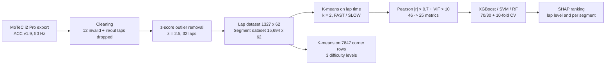

# Hojaji2024_KPIPrediction — AI-enabled prediction of sim racing performance using telemetry data

**1. Provenance & Objective**
- Citation: F. Hojaji, A. J. Toth, J. M. Joyce, M. J. Campbell (Esports Science Research Lab, Lero, University of Limerick), *Computers in Human Behavior Reports* 14 (2024) 100414. DOI: 10.1016/j.chbr.2024.100414. `Hojaji2024_KPIPrediction.pdf` (Zotero key `73TCIYW6`; corpus file currently named `Hojaji2024_AI.pdf`; volume and article number from the journal header, p. 1)
- Dates: received 18 Dec 2023, revised 5 Apr 2024, accepted 9 Apr 2024, online 16 Apr 2024 (p. 1 footer). Data recording dates are not stated in this paper.
- Licence: the article footer says CC BY 4.0 (p. 1). The University of Limerick repository cover sheet in our PDF says CC BY-NC-SA 4.0 (cover page, not part of the article). The two disagree; cite the article licence for reuse and flag the difference.
- Role in this vault: **this is the source paper of the thesis dataset** (Brands Hatch, ACC, McLaren 720S GT3; [[AGENTS]] §0). It states itself to be "a significant extension of our previous works (Hojaji et al., 2022, 2023)" (`Sec. 1.3`), i.e. [[Hojaji2023_TelemetryML]] (AICS 2022) and [[Hojaji2024_DrivingBehaviour]] (GALA 2023). The later EA paper is [[Hojaji2026_TelemetryEA]].
- Core Goal: three aims (`Sec. 1.3`):
  - A1 "identify the metrics that best predict sim racing performance, across different levels of expertise";
  - A2 use those metrics to investigate behavioural patterns among racers;
  - A3 "determine the level of difficulty for each corner of the racing track through by conducting track segment analyses."
- Code/data: all processing scripts at GitHub `ESRLAccount/SimRacing_KPITelemetryDataAnalysis` (`Sec. 2.3`, footnote 1). "The main datasets have been included as supplementary files" (`Data availability`, p. 12); supplementary files 1–9 are referenced across `Sec. 2.3` and `Sec. 4.3`.

**2. Methodology Breakdown**
- Participants: 174 young, healthy adults, mean age 30.44 ± 10.19 years, recruited from University of Limerick and Irish sim-racing societies; 85% held a driving licence (`Sec. 2.1`).
- Rig: Sparco Grid Q Fibreglass seat on SRC Pro V2 chassis, Logitech Pro wheel and pedals (brake, clutch, accelerator), "a single, large 32″ MSI MPG321QRF-QD widescreen monitor", high-end consumer gaming PC (model not reported) (`Sec. 2.2`). Note: the photo in `Fig. 1` shows three monitors.
- Simulator, car, circuit: Assetto Corsa Competizione v1.9 (`Abstract`), McLaren 720S GT3, Brands-Hatch Grand Prix circuit, official track divisions used as segments (`Sec. 2.2`, `Fig. 2`). Telemetry via MoTeC i2 Pro v1.1.5; up to 74 data features; time series at 50 Hz (`Sec. 2.3`).
- Task: "drive as quickly as they could while keeping the car on the track"; session approx. 30 min. Laps per participant: the text literally reads "Participants completed X laps" — an unfilled placeholder in the published paper (`Sec. 2.3`).
- Segmentation: **19 segments = 10 straights (S1–S10) + 9 turns (T1–T9)** (`Table 1` caption, `Fig. 2`). This is the same M = 19 microsector split the thesis uses ([[AGENTS]] §0). Segment boundaries in metres are drawn in `Fig. 2` (161 m, 421 m, 504 m, 758 m, 790 m, 1012 m, 1140 m, 1400 m, 1913 m, 2173 m, 2244 m, 2504 m, 2630 m, 2840 m, 2923 m, 3133 m, 3323 m, 3623 m); the boundary-to-segment assignment is only graphical.
- Raw datasets (`Table A1`, p. 13):

| Datafile | Rows | Columns | Content |
| :--- | :--- | :--- | :--- |
| Lap_time data | 1327 | 26 | session details, lap times, segment times |
| lap-specific behavioural data | 1327 | 74 | per-lap means of driver and vehicle features |
| segment-specific behavioural data | 15,694 | 74 | per segment/lap/participant means |
| time-series driving data | 22,800 | 87 | one file per participant, 174 files |

- Pre-processing (`Sec. 2.3`, `Fig. 3`):
  - Missing values in the behavioural datasets replaced by feature means (after Tabachnick & Fidell).
  - 12 invalid laps omitted, incl. zero lap times from MoTeC disconnects; out-laps and in-laps excluded.
  - "A total of 1327 laps were included and subjected to additional criteria for outlier removal using the z-score normalization method"; threshold z = 2.5, chosen over 1 and 2 for "a marginal enhancement in accuracy", "resulting in the exclusion of 32 laps".
  - Time-series normalization: one row per lap-distance indicator, by averaging all data at that distance.
  - Standardization to zero mean, unit SD (sklearn), per participant for the segment data.
  - Result: two datasets of 62 features — lap-specific (1327 laps) and segment-specific (15,694 rows) (`Sec. 2.3`, `Sec. 3`).
- Software: Python 3.9, Anaconda 3 / Spyder 5.2, scikit-learn, XGBoost, scipy, shap (`Sec. 2.3`, `Sec. 3.2.1`, `Sec. 3.2.3`, `Sec. 4.2`). **Compute hardware and runtimes: not reported in the source.**
- Performance labels (`Sec. 3.1`): K-means on lap time only (1-D array for laps; 2-D array of lap time and segment time for segments). k chosen by Elbow and Silhouette. Settings: `k-means++` init, `n_init` = 2, `max_iter` = 1000, `random_state` = 42.
- Derived features (`Sec. 3.2.1`, `Table A2`): brake start, peak, end and peak value per brake (scipy peak detection, small peaks dropped, averaged per lap); steering max, zero crossings, angular travel; throttle application; lane deviation, understeer, oversteer, steering reversal rate per lap and per segment, trail braking duration. `Table A2` marks each as a raw MoTeC channel (C) or a computed math channel (M). The formulas are in supplementary file 8, not in the paper (`Sec. 2.3`).
- Feature selection, "hybrid" filter + wrapper after Mandal et al. (`Sec. 3.2.3`):
  - Per-lap **means only** (min, max, SD dropped "to streamline the feature set").
  - Pearson matrix; many pairs with |r| > 0.7.
  - Iterative VIF elimination, removing the highest VIF > 10 until none is left. "Out of the 46 metrics that resulted from Pearson analysis, 21 were eliminated ... The remaining 25 metrics were input into ML".
  - Bootstrapping across Gradient Boosting (XGBoost), SVM and Random Forest classifiers; XGBoost kept.
- Validation (`Sec. 4.2`): 70/30 train/validation split, plus 10-fold CV; metrics are MAE, accuracy, F1, AUC. Split unit (lap or driver) not stated. `Sec. 6` says the folds were stratified ("10-fold samples with roughly identical target class distributions").
- Corner difficulty (A3, `Sec. 3.2.4`): Elbow + Silhouette + K-means on corner rows only (7847 rows). Inputs are segment time, segment length and the top 10 metrics from A1.

*(counts from `Sec. 2.3`, `Sec. 3.2.3`, `Sec. 3.2.4`, `Sec. 4.1`; the paper's own flow is `Fig. 3`, which also draws a "loop until accuracy is acceptable" back from hyper-parameter tuning to performance analysis. Tuning details are not reported.)*

**3. Key Findings & Performance Metrics**

*Dataset statistics, seconds* (`Table 1`; all laps, filter state not stated):

| | Lap | S1 | T1 | S2 | T2 | S3 | T3 | S4 | T4 | S5 | T5 | S6 | T6 | S7 | T7 | S8 | T8 | S9 | T9 | S10 |
| :--- | :--- | :--- | :--- | :--- | :--- | :--- | :--- | :--- | :--- | :--- | :--- | :--- | :--- | :--- | :--- | :--- | :--- | :--- | :--- | :--- |
| mean | 93.39 | 4.0 | 4.1 | 4.3 | 6.5 | 2.2 | 4.9 | 5.3 | 5.3 | 12.0 | 3.7 | 3.6 | 4.3 | 4.6 | 4.1 | 2.1 | 4.8 | 6.0 | 4.0 | 7.4 |
| max | 137.54 | 16.8 | 8.4 | 18.1 | 20.2 | 4.3 | 17.0 | 28.6 | 21.0 | 30.6 | 5.9 | 12.6 | 14.3 | 20.1 | 10.9 | 20.2 | 14.4 | 17.3 | 23.0 | 22.2 |
| min | 85.05 | 3.5 | 3.5 | 3.7 | 6.0 | 2.0 | 4.4 | 4.8 | 4.8 | 11.2 | 3.0 | 3.3 | 3.7 | 4.2 | 3.2 | 1.7 | 4.0 | 5.6 | 3.1 | 6.9 |
| std | 7.90 | 0.8 | 0.5 | 1.2 | 0.8 | 0.2 | 0.7 | 1.5 | 1.0 | 1.6 | 0.4 | 0.7 | 0.6 | 0.9 | 0.8 | 1.3 | 0.8 | 0.6 | 1.1 | 0.8 |

The 19 segment means sum to 93.2 s against a 93.39 s lap mean (our arithmetic).

*Clustering* (`Sec. 4.1`, `Fig. 4`, `Sec. 6`):

| Cluster | n laps | Mean ± SD (s) | Min (s) | Max (s) |
| :--- | :--- | :--- | :--- | :--- |
| FAST | 850 (`Sec. 6`) | 96.63 ± 7.71 | 85.04 | 113.65 |
| SLOW | 477 (`Sec. 6`) | 130.68 ± 13.3 | 113.77 | 166.63 |

- Elbow/Silhouette preferred k = 2 or 4; k = 2 was chosen "As we aimed to determine the main difference between elite and low skill sim races"; silhouette 0.81 (`Sec. 4.1`).
- In total 20 clustering outputs: 1 lap-level plus 19 per-segment (`Sec. 4.1`).

*Classification of FAST vs SLOW* (`Sec. 4.2`, `Fig. 5`):

| Model | AUC | Other | Source |
| :--- | :--- | :--- | :--- |
| XGBoost | 0.9713 (text: 0.971) | accuracy 0.96, F1 0.93, "absolute mean error" 0.011 | `Fig. 5`, `Sec. 4.2` |
| Random Forest | 0.951 | not reported | `Fig. 5` |
| SVM | 0.7902 | not reported | `Fig. 5` |

- Headline: "The best model achieved a prediction accuracy of 97.19%" (`Abstract`; "maximum accuracy of 97.19%", `Sec. 7`). This disagrees with the 0.96 accuracy in `Sec. 4.2` and is closer to the 0.9713 AUC. Which number is accuracy is unresolved in the source.
- The target is the binary k-means label (FAST/SLOW), not lap time. Class balance is 850 : 477 (`Sec. 6`). Which split or fold produced each metric is not stated.

*Lap-level SHAP ranking, XGBoost, mean |SHAP|* (`Fig. 6`, bar labels as printed): speed 3.7; absolute lateral accel. 1.51; steering reversal rate/lap 0.72; lane deviation 0.66; absolute steering angle 0.64; oversteer 0.44; absolute longitudinal accel. 0.36; steering duration 0.28; trail braking duration 0.25; brake 0.19; number of zero crossing 0.13; steering reversal rate/sector 0.09; throttle application 0.06; maximum value of steering 0.05; "sum of 2 other features" 0.01.

*Segment-level importance, averaged over corners or straights, error bars = SD* (`Fig. 7`, read from chart; metric of "Importance Score" not defined):

| Rank | Corners (`Fig. 7a`) | Straights (`Fig. 7b`) |
| :--- | :--- | :--- |
| 1 | absolute longitudinal accel. ~0.89 | throttle application ~0.75 |
| 2 | speed ~0.81 | speed ~0.46 |
| 3 | ROTY ~0.62 | absolute lateral accel. ~0.44 |
| 4 | oversteer ~0.52 | absolute steering angle ~0.33 |
| 5 | trail braking duration ~0.36 | ROTY ~0.30 |
| 6 | lane deviation ~0.31 | steering reversal rate per sector ~0.28 |
| 7 | absolute lateral accel. ~0.24 | brake ~0.22 |
| 8 | throttle ~0.19 | oversteer ~0.15 |
| 9 | absolute steering angle ~0.12 | lane deviation ~0.15 |
| 10 | steering reversal rate per sector ~0.07 | understeer ~0.10 |

*FAST vs SLOW group means* (`Table 2`, whole lap; `Table 3`, cornering):

| Metric | Lap FAST | Lap SLOW | Lap FAST:SLOW | Corner FAST | Corner SLOW | Corner FAST:SLOW |
| :--- | :--- | :--- | :--- | :--- | :--- | :--- |
| speed | 146.28 | 109.92 | 1.33 | 126.03 | 87.55 | 1.44 |
| absolute lateral acceleration | 0.72 | 0.51 | 1.4 | 1.16 | 0.66 | 1.76 |
| absolute longitudinal acceleration | 0.42 | 0.31 | 1.35 | 0.41 | 0.09 | 4.39 |
| lane deviation | 0.24 | 0.18 | 1.29 | 0.53 | 0.28 | 1.93 |
| absolute steering angle | 28.98 | 44.43 | 0.65 | 34.69 | 48.79 | 0.71 |
| oversteer | 0.04 | 0.13 | 0.31 | 0.174 | 0.70 | 0.24 |
| trail braking duration | 18.28 | 13.2 | 1.38 | 2.46 | 6.80 | 0.36 |
| steering reversal rate per sector | 0.70 | 0.81 | 0.88 | 1.42 | 1.02 | 1.38 |
| steering reversal rate per lap | 14.15 | 16.04 | 0.88 | not reported | not reported | — |
| steering duration | 601.67 | 854.77 | 0.70 | not reported | not reported | — |
| brake | 10.27 | 6.9 | 1.48 | not reported | not reported | — |
| number of zero crossing | 8.1 | 6.4 | 1.26 | not reported | not reported | — |
| throttle application | 252.68 | 189.4 | 1.33 | not reported | not reported | — |
| maximum value of steering | 76.79 | 84.4 | 0. 9 (as printed) | not reported | not reported | — |
| ROTY | not reported | not reported | — | 19.41 | 15.31 | 1.26 |
| throttle | not reported | not reported | — | 54.13 | 22.73 | 2.38 |

Units are not given in `Tables 2–3`; see `Table A2` for each channel's unit.

*Driving-pattern statements* (`Sec. 4.3`, `Figs. 8–9`):
- FAST vs SLOW differences are largest in the first three corners, especially T2, "a hairpin style corner that requires threshold braking in a straight line". There is "a little variation in the last segment of the track (i.e., last two corners)".
- FAST laps press the throttle 2.38 times more than SLOW laps in corners (`Table 3`).
- Maximum braking differs between groups: t-test p = 0.002. Sample unit and test variant not stated.
- FAST laps reach the brake peak "33 times more rapidly", especially in the last five corners.
- At braking > 35%, mean steering angle is −6.5° for FAST and −29.12° for SLOW.
- FAST laps show 1.93 times more lane deviation, and oversteer "0.24 times less frequent".
- G-G plots: FAST laps "drive more around the rim of the traction circle" (`Fig. 9`).

*Corner difficulty* (`Sec. 4.4`, `Fig. 10`):
- Level 3 = T2. Level 2 = T3, T4, T8. Level 1 = T1, T5, T6, T7, T9.
- "the clustering algorithm applied to the dataset achieved an accuracy rate of 86.34%"; no ground truth is defined for this accuracy.

**4. Critique & Optimization Vectors**
- **Human drivers, descriptive output only.** The paper ranks metrics and describes FAST/SLOW group differences. It does not produce a per-driver or per-segment target that a driver could act on. It points to "applying ML techniques for trajectory prediction" and finding "the optimal racing line" as the next step (`Sec. 5`). This is the gap that [[Hojaji2026_TelemetryEA]] and this thesis fill.
- **Classification of a self-made label, not lap-time regression.** XGBoost predicts the k-means label, and k-means was fit on lap time (`Sec. 3.1`, `Sec. 4.2`). The 97.19%/0.96 figures therefore measure how well telemetry recovers a 1-D lap-time threshold between 113.65 and 113.77 s (`Sec. 4.1`, our inference). This is a weak claim from one 70/30 split plus CV with an unstated split unit (`Sec. 4.2`). Our surrogate instead regresses microsector time and exit speed ([[AGENTS]] §0).
- **Car-response channels dominate the ranking.** The top two lap-level features, speed and absolute lateral acceleration (`Fig. 6`), and the top two corner features, longitudinal acceleration and speed (`Fig. 7a`), are outcomes of driving, not driver inputs. Speed predicting a lap-time cluster is close to tautological. This supports the thesis rule that car-response channels are not candidate KPIs ([[AGENTS]] §0).
- **Possible driver leakage.** The 70/30 split and 10-fold CV are not stated as driver-grouped (`Sec. 4.2`), so laps of one participant may sit in both train and validation. The thesis splits by driver ([[AGENTS]] §0).
- **Segment-level analysis exists but is averaged away.** `Fig. 7` averages per-corner importance over all corners and over all straights. Per-segment rankings, per-segment model accuracy and the importance metric itself are not reported. Each segment is treated as independent, so carry-over between segments is not modelled. The authors only say behaviour "in some track segments were much more important to the success of the entire lap than others" (`Sec. 5`). That interdependency is our microsector-chaining question.
- **Internal count inconsistencies (verify against the released CSV before quoting).**
  - 1327 laps are reported both before the 32-lap z-score removal and as the final dataset; FAST 850 + SLOW 477 = 1327 (`Sec. 2.3`, `Sec. 6`, our arithmetic).
  - `Table 1` gives a lap max of 137.54 s, but the SLOW cluster max is 166.63 s (`Sec. 4.1`).
  - 15,694 segment rows / 19 segments = 826 laps, not 1327 (our arithmetic). 7847 corner rows / 9 corners is not an integer (our arithmetic; `Sec. 3.2.4`).
  - The vault's cleaned count of 817 laps / 165 drivers ([[AGENTS]] §0) comes from our own cleaning of the released file, not from this paper.
- **Feature counts do not close.** VIF leaves 25 metrics for ML (`Sec. 3.2.3`), but `Fig. 6` shows 15 features plus "sum of 2 other features" = 17 (our count). The 62 → 46 step (Pearson) is not itemised.
- **Contradictory trail-braking direction.**
  - Lap-level trail braking is higher for FAST (18.28 vs 13.2, `Table 2`). In corners it is lower for FAST (2.46 vs 6.80, `Table 3`).
  - `Fig. 8`'s caption says FAST laps have "a low percentage of trail braking duration".
  - `Sec. 7` says "a shorter lap-time may arise with applying greater trail braking duration".
  - The source does not resolve this.
- **Tuned but never swept.** The z-score threshold was tried at 1, 2 and 2.5, picked for "a marginal enhancement in accuracy" with no numbers given (`Sec. 2.3`). k = 2 was picked over the equally preferred k = 4 by intent, not by score (`Sec. 4.1`). `n_init` = 2 is unusually low (`Sec. 3.1`). XGBoost hyperparameters are not reported, despite the "loop until accuracy is acceptable" in `Fig. 3`.
- **Clustering "accuracy" of 86.34% has no ground truth** (`Sec. 4.4`), so the metric is undefined as reported.
- **Admitted gaps (quoted).**
  - Off-track: "MoTec provides no information regarding off-tracking ... a few off-tracking laps may have still been included in the final data set". The proposed fix is a reader on ACC shared memory (`Sec. 6`).
  - Imbalance: "our clustering produced SLOW cluster with a small number of laps (n = 477) compared to the number of laps included in the FAST cluster (n = 850)". XGBoost sample weighting is left to "future analyses" (`Sec. 6`).
  - Generality is asserted, not shown: "While our current study focuses on results from a single track, the methodology and algorithms employed are not specific to that track" (`Sec. 5`).
- **Scales badly / single configuration.** One simulator (ACC v1.9), one car (McLaren 720S GT3), one circuit (Brands Hatch GP), one lab rig (`Sec. 2.2`). No runtime or compute hardware is reported, so the cost of the pipeline is unknown (`Sec. 2.3`).
- **Reporting defects.** "Participants completed X laps" is an unfilled placeholder (`Sec. 2.3`). The text says one monitor, but `Fig. 1` shows three (`Sec. 2.2`). The licence differs between the article (CC BY) and the repository cover sheet (CC BY-NC-SA).
