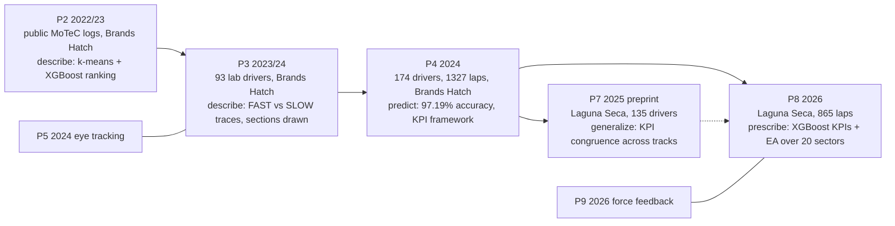

# Literature Review: the Hojaji corpus (sim-racing telemetry, 2022–2026)

Date: 2026-10-03. Slug: `hojaji-2026`. Publication log: `notes/hojaji-2026-publications.md` [16].

## 1. Scope and coverage

Subject: Fazilat Hojaji, Esports Science Research Lab / Lero, University of Limerick, ORCID 0000-0002-8866-0278. Core co-authors are Adam J. Toth and Mark J. Campbell. The anchor paper is [[Hojaji2026_TelemetryEA]] (ICAART 2026) [8, 19].

Ten esports papers (P1–P10) were found through Semantic Scholar, OpenAlex and Crossref. Earlier work (2010–2019) is on SOA governance and model execution tracing. It is outside the thesis scope and is not reviewed.

| Code | Paper | Read level |
| :--- | :--- | :--- |
| P1 | Toth, Hojaji, Campbell, *CHB* 2023, FPS target acquisition, [10.1016/j.chb.2022.107554](https://doi.org/10.1016/j.chb.2022.107554) | abstract only [1] |
| P2 | Hojaji, Toth, Campbell, AICS 2022 (CCIS 2023), [10.1007/978-3-031-26438-2_8](https://doi.org/10.1007/978-3-031-26438-2_8) | full, [[Hojaji2023_TelemetryML]] [2, 17] |
| P3 | Hojaji, Toth, Joyce, Campbell, GALA 2023 (LNCS 2024), [10.1007/978-3-031-49065-1_19](https://doi.org/10.1007/978-3-031-49065-1_19) | full, [[Hojaji2024_DrivingBehaviour]] [3, 18] |
| P4 | Hojaji, Toth, Joyce, Campbell, *CHB Reports* 14, 100414, 2024, [10.1016/j.chbr.2024.100414](https://doi.org/10.1016/j.chbr.2024.100414) | abstract only (publisher blocked) [4, 11] |
| P5 | Joyce, Campbell, Hojaji, Toth, *Vision* 8(2):27, 2024, [10.3390/vision8020027](https://doi.org/10.3390/vision8020027) | full (PMC) [5, 12] |
| P6 | Hojaji et al., *CHB Reports* 2025, League of Legends KPIs, [10.1016/j.chbr.2025.100718](https://doi.org/10.1016/j.chbr.2025.100718) | abstract only [6, 13] |
| P7 | Hojaji, Toth, Joyce, Murphy, Campbell, SSRN preprint 2025, cross-track KPI consistency, [10.2139/ssrn.5255017](https://doi.org/10.2139/ssrn.5255017) | search-result text only [7, 14] |
| P8 | Hojaji, Toth, Campbell, ICAART 2026, [10.5220/0014609600004052](https://doi.org/10.5220/0014609600004052) | full, [[Hojaji2026_TelemetryEA]] [8, 19] |
| P9 | Murphy, Toth, Hojaji, Campbell, *CHB Reports* 2026, force feedback, [10.1016/j.chbr.2026.100993](https://doi.org/10.1016/j.chbr.2026.100993) | abstract-level only [9, 15] |
| P10 | Campbell, Hojaji, Cregan, Toth, Routledge chapter 2026, [10.4324/9781003663676-5](https://doi.org/10.4324/9781003663676-5) | title only [10] |

**Coverage limit.** Only P2, P3, P5 and P8 were read in full. P4 is the paper that P8 names as its framework and KPI-definition source (P8 `Sec. 3`, `Sec. 4.1`) [8, 19], and its full text could not be read here. Every P4 and P7 statement below comes from the abstract or from search-result text, and is labelled.

## 2. Research trajectories

*(Counts: P2 `Sec. 2.2` [17]; P3 `Sec. 2.1` [18]; P4 abstract [11]; P7 search-result text [14]; P8 `Sec. 3.1–3.2` [19]. The P7 → P8 link is inferred: both report 135 participants and 1,180 laps. P8's reference list contains no P7 entry [8].)*

### T1 — Telemetry KPI ranking, from description to prescription (P2 → P3 → P4 → P7 → P8)

The core line keeps one method and changes the question.

| Paper | Data | Labels | Model | Question type | Granularity |
| :--- | :--- | :--- | :--- | :--- | :--- |
| P2 | ACC, Brands Hatch, public MoTeC servers, 782 laps (`Sec. 2.1–2.2`) [17] | k-means, k = 3 (`Sec. 3.1`) [17] | XGBoost vs RF vs SVM, 70/30 split (`Sec. 3.2`) [17] | which features matter | lap |
| P3 | ACC, Brands Hatch, 93 lab participants, 557 laps (`Sec. 2.1–2.2`) [18] | k-means, k = 2 (`Sec. 3.1`) [18] | none beyond clustering | how FAST and SLOW laps differ along the track | lap; 18 sections drawn, not measured (`Sec. 3.2`) [18] |
| P4 | ACC v1.9, Brands Hatch, 174 participants, 1,327 laps (abstract) [11] | clustered by lap time (abstract) [11] | hybrid selection, three ML models, best accuracy 97.19 % (abstract) [11] | predict performance level | not known from abstract |
| P7 | Laguna Seca, 135 participants, 1,180 laps (search text) [14] | clustering (search text) [14] | not known | do KPIs hold across tracks | not known |
| P8 | ACC v1.9, McLaren 720S GT3, Laguna Seca, 865 laps (`Sec. 3.1–3.2`) [19] | k-means, k = 3 (`Sec. 3.3`) [19] | XGBoost (Acc 0.87, F1 0.85, AUC 0.90) + EA (`Sec. 3.4–3.5`) [19] | generate an idealized lap | global importance; EA over 20 sectors (`Sec. 3.5.1`, `Sec. 5`) [19] |

The line moves from public, pooled logs (P2) to controlled lab and event data (P3, P4, P8). It moves from "which features" (P2) to "what should the driver do" (P8). The lap stays the unit of the importance model in every paper read in full.

### T2 — Perception and hardware in sim racing (P5, P9)

P5 uses eye tracking (Tobii Pro Glasses 3, 50 Hz) on ACC, McLaren 720S GT3, Brands Hatch. N = 88, top vs bottom 25 % by lap time (n = 22 each) [12]. High-skilled racers had a lower TRACK:HUD fixation ratio, 2.44 ± 1.06 vs 4.11 ± 2.27, p = 0.003, d = 0.969 (P5 `Table 1`) [12]. P5 also tests fixation time pooled over 9 corner sectors (normalised corner TFD 101.70 % vs 113.79 %, p = 0.018, d = 0.740; P5 `Table 2`) [12]. This is the only statistical test at corner level found in the corpus. P5 reports corner metrics averaged over the 9 corners, not per corner [12].

P9 tests force and vibrotactile feedback in iRacing (BMW M4 GT3, Brands Hatch, 59 racers, 4 conditions) [15]. Per its abstract-level summary, force feedback alone gave faster lap times and vibrotactile feedback gave no benefit [15]. Statistics were not read.

### T3 — The same KPI-ranking method in other esports (P1, P6, P10)

P6 applies neural networks to 154,000 League of Legends games and reports 97 % win-prediction accuracy (abstract) [6, 13]. P1 decomposes an FPS aiming movement into kinematic phases (abstract) [1]. P10 is a book chapter on expertise and talent identification (title only) [10]. These show the lab treats "rank KPIs by ML" as a general esports method. They add no sim-racing evidence.

## 3. Pivotal papers

Ranked by how much each changed the direction of the corpus, not by venue.

1. **P8 (2026)** — first prescriptive step. It turns a ranking into an optimizer that outputs a 20-sector × 10-KPI target (`Sec. 3.5.1`) [19]. It also states the sector gap most clearly (`Sec. 5`). Method weakness: the fitness is a hand-set linear surrogate, not the trained model (`Sec. 3.5.2`), and the ~81–82 s result is close to the 90 % clamp floor of 81.945 s (our arithmetic from `Sec. 3.5.2`, `Sec. 4.2`) [19].
2. **P2 (2022/23)** — origin. First ML on sim-racing telemetry by this lab, and the first place the segment-level question is deferred: *"It would also be possible to focus on a specific segment rather than the data for the full lap to estimate the lap time. We defer this work as the future work."* (`Sec. 3.2`) [17].
3. **P4 (2024)** — framework paper. P8 adopts "the same analytical framework" and defers all KPI definitions to it (P8 `Sec. 3`, `Sec. 4.1`) [19]. Largest sample in the line, 174 participants (abstract) [11]. Its method details are unread here.
4. **P7 (2025, preprint)** — first cross-track test. Search-result text [14] says average speed, lateral acceleration, steering reversal rate and lane deviation "showed high congruence" between Laguna Seca and Brands Hatch. No rank-shift number was retrievable. Not peer reviewed as of 2026-10-03.
5. **P3 (2023/24)** — first paper in the corpus to overlay track sections (S1–S9, T1–T9) on telemetry. Differences between FAST and SLOW were judged by eye to sit in the first three corners (`Sec. 3.2`) [18], with no per-section statistic.

## 4. Consensus

- **Speed ranks first.** P2 (`Fig. 3`) [17], P4 (abstract: "average speed") [11], and P8 (`Fig. 2`, read from chart) [19] all put speed first.
- **Lateral acceleration ranks high.** Third in P2 (`Fig. 3`), second in P4 (abstract) [11], second in P8 (`Fig. 2`, ~0.96, read from chart) [19].
- **Lane deviation recurs.** In the top 10 of P2 (`Fig. 3`) and P8 (`Fig. 2`), and fourth in P4 (abstract) [11].
- **Method stack is stable.** k-means for labels, chosen by Elbow and Silhouette, then tree-based classifiers with XGBoost best (P2 `Sec. 3.1–3.2` [17]; P3 `Sec. 3.1`, k-means step only [18]; P8 `Sec. 3.3–3.4` [19]).

These rankings come from different tracks (Brands Hatch for P2/P4, Laguna Seca for P8) and different data sources. The agreement is in rank order only. Importance values are not comparable across papers.

## 5. Disagreements and inconsistencies

| Issue | Evidence |
| :--- | :--- |
| P8 text vs P8 figure on top KPIs | Text lists "speed, trail-braking duration, steering angle, oversteer, and lane deviation" (`Sec. 4.1`). In `Fig. 2` trail braking is ~10th and oversteer ~9th (read from chart) [19]. |
| Number of performance classes | k = 3 in P2 (`Sec. 3.1`) [17] and P8 (`Sec. 3.3`) [19]; k = 2 in P3 (`Sec. 3.1`) [18]. |
| Reported accuracy | P2: "absolute accuracy of 92.2%" (`Sec. 3.2`) [17]. P3: 81.42 % with no definition (`Sec. 3.1`) [18]. P4: 97.19 % (abstract) [11]. P8: 0.87 (`Sec. 3.4`) [19]. Different data, tracks and label schemes, so not comparable. |
| Class balance | Never addressed. P2: 475 FAST vs 91 SLOW (`Table 2`) [17]. P3: 441 vs 115 (`Table 1`) [18]. P8: not reported (`Sec. 3.3`) [19]. |
| P8 baseline value | Baseline "derived from fast human laps" (`Sec. 3.5.1`), but the start value is 91.05 s (`Sec. 4.2`), near the medium-cluster mean of 91.2 s (`Sec. 3.3`) [19]. |

## 6. What the corpus leaves open (thesis relevance)

Each item maps to [[GOAL]].

1. **Sector-level importance is never computed.** Named as future work in P2 (`Sec. 3.2`) [17] and P8: *"feature importance in this study was computed globally rather than at the individual sector level ... Future work could therefore explore segment-level models"* (`Sec. 5`) [19]. Sections exist as plot bands (P3) and as EA genes (P8), never as model units. → G2, G2.3.
2. **Corner interdependency is not modeled.** P8's lap time is a sum of independent sector terms. The only coupling is a smoothness penalty whose form is not reported (`Sec. 3.5.2`) [19]. P3 notes a T2 → T3 carry-over in prose only (`Sec. 3.2`) [18]. → G2.
3. **The optimized lap is never driven.** P8's output is a KPI vector scored by a surrogate. No simulator replay or human validation (`Sec. 4–6`) [19]. → G4.
4. **No code or data release** was found for P2, P3, P4, P7 or P8. P5 data is "on email request" [12]. → risk R6 holds. The thesis baseline must be our own global-importance model.
5. **One track per study.** Each paper read in full uses one sim, one track. P7 is the only cross-track test, and its numbers are unread. → generalization claims stay weak.
6. **Segmentation rule unstated.** P8's 20 sectors are "10 corner-dominant and 10 straight-dominant" with no boundary rule (`Sec. 3.5.1`) [19]. P3's section bands came "from professional drivers" with no positions (`Sec. 3.2`) [18]. → G1 must define and publish its own rule.

## 7. Next research decisions

1. **Get the P4 PDF.** It is CC-BY open access [20]. Open https://doi.org/10.1016/j.chbr.2024.100414 in a normal browser, save to `01_Corpus/`, then `/zotero-ingest`. It holds the KPI definitions P8 depends on.
2. **Get the P7 PDF** from SSRN (abstract 5255017). It is the only cross-track evidence and the nearest prior work to a "does importance change by location" question.
3. **Get the P9 PDF** (CC BY-NC-ND) only if hardware or input device becomes a control variable in G1.
4. **Follow-up reading** from the P4 and P7 reference lists (Crossref): Remonda et al. 2021 (cited by P4) [20] and a Remonda 2025 benchmark (cited by P7) [21]. Their topic was not checked.
5. **Ask the authors** (M. J. Campbell is the data contact in P5 [12]) whether the Laguna Seca segment dataset can be shared. That would allow a direct G2.3 comparison against P8.

## Open Questions

- Does P4 contain any segment-level analysis? Search-result text mentioned "19 segments" and "15,694 segment rows" [22]. This is unverified and is not used above.
- Does P7 report a rank correlation or per-KPI shift between tracks?
- Is P7's dataset the same Gamescom 2024 dataset as P8? Matching counts suggest yes [14, 19]. Not confirmed.

## Sources

DOI resolution checked 2026-10-03 with `curl -sIL`. Final HTTP status in brackets.

1. Toth, Hojaji, Campbell, CHB 2023 (P1) — https://doi.org/10.1016/j.chb.2022.107554 [200, ScienceDirect]
2. Hojaji, Toth, Campbell, AICS 2022 (P2) — https://doi.org/10.1007/978-3-031-26438-2_8 [200, Springer]
3. Hojaji, Toth, Joyce, Campbell, GALA 2023 (P3) — https://doi.org/10.1007/978-3-031-49065-1_19 [200, Springer]
4. Hojaji, Toth, Joyce, Campbell, CHB Reports 14, 100414 (P4) — https://doi.org/10.1016/j.chbr.2024.100414 [200 at linkinghub redirect; article page itself returned 403 to research tools]
5. Joyce, Campbell, Hojaji, Toth, Vision 8(2):27 (P5) — https://doi.org/10.3390/vision8020027 [403 from MDPI after redirect; resolves]
6. Hojaji et al., CHB Reports 2025 (P6) — https://doi.org/10.1016/j.chbr.2025.100718 [200]
7. Hojaji et al., SSRN 2025 (P7) — https://doi.org/10.2139/ssrn.5255017 [403 from SSRN after redirect; resolves]
8. Hojaji, Toth, Campbell, ICAART 2026 (P8) — https://doi.org/10.5220/0014609600004052 [200]; public PDF https://www.scitepress.org/Papers/2026/146096/146096.pdf
9. Murphy, Toth, Hojaji, Campbell, CHB Reports 2026 (P9) — https://doi.org/10.1016/j.chbr.2026.100993 [200]
10. Campbell, Hojaji, Cregan, Toth, Routledge chapter 2026 (P10) — https://doi.org/10.4324/9781003663676-5 [503 from Taylor & Francis at check time; redirect resolves, retry later]
11. UL Pure, P4 abstract — https://pure.ul.ie/en/publications/ai-enabled-prediction-of-sim-racing-performance-using-telemetry-d/
12. PMC, P5 full text — https://pmc.ncbi.nlm.nih.gov/articles/PMC11130932/
13. UL Pure, P6 abstract — https://pure.ul.ie/en/publications/deep-learning-techniques-for-identifying-kpis-in-league-of-legend/
14. SSRN, P7 page (search-result text only; page blocked) — https://papers.ssrn.com/sol3/papers.cfm?abstract_id=5255017
15. ScienceDirect, P9 (abstract-level summary via search tool) — https://www.sciencedirect.com/science/article/pii/S2451958826000679
16. Publication log — `notes/hojaji-2026-publications.md`
17. Vault note, P2 — `02_Source_Notes/Hojaji2023_TelemetryML.md`; PDF `01_Corpus/ingested/2023/Hojaji2023_TelemetryML.pdf`
18. Vault note, P3 — `02_Source_Notes/Hojaji2024_DrivingBehaviour.md`; PDF `01_Corpus/ingested/2024/Hojaji2024_DrivingBehaviour.pdf`
19. Vault note, P8 — `02_Source_Notes/Hojaji2026_TelemetryEA.md`; PDF `01_Corpus/ingested/2026/Hojaji2026_TelemetryEA.pdf`
20. Crossref, P4 record (CC-BY licence per DOAJ; reference list) — https://api.crossref.org/works/10.1016/j.chbr.2024.100414 ; https://doaj.org/api/search/articles/doi:10.1016/j.chbr.2024.100414
21. Crossref, P7 record (reference list) — https://api.crossref.org/works/10.2139/ssrn.5255017
22. ScienceDirect, P4 page (search-result text only; unverified) — https://www.sciencedirect.com/science/article/pii/S2451958824000472
